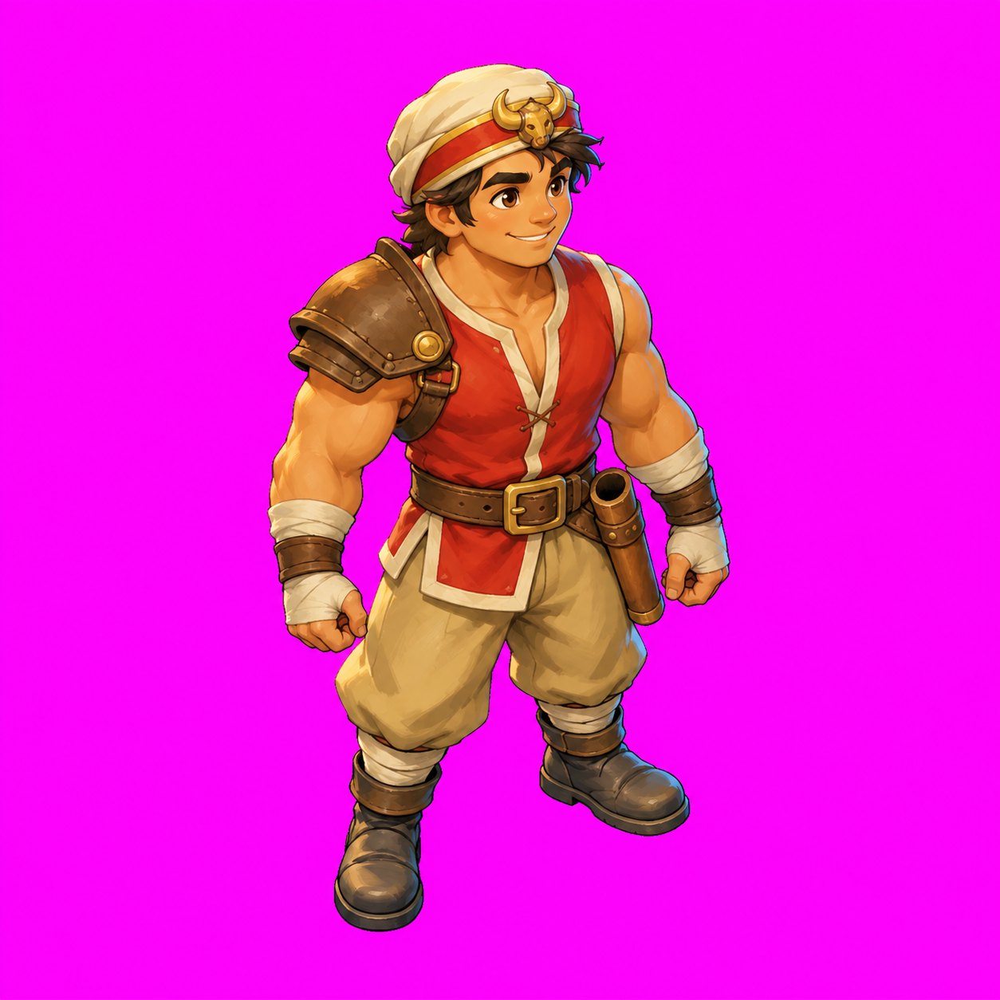
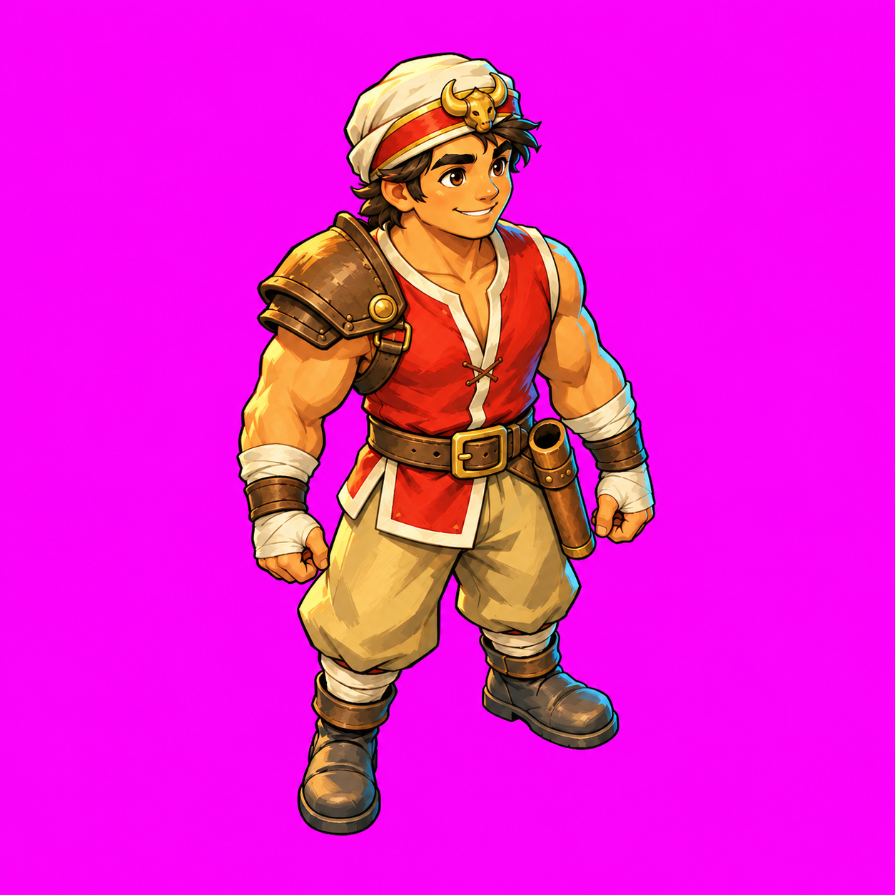
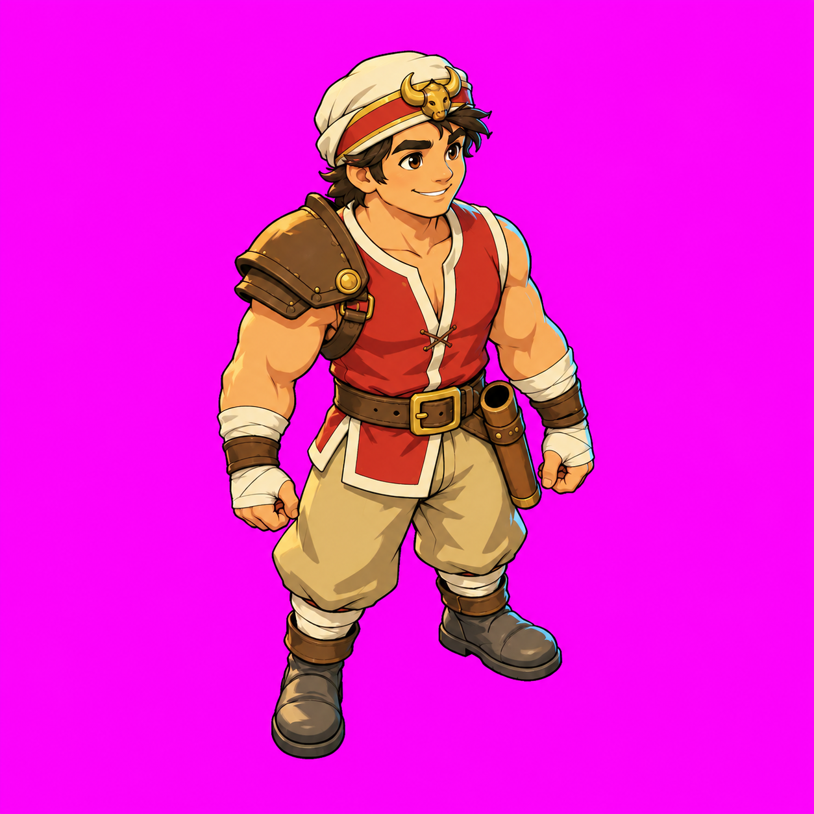

# Shot 1 — Buffalo style options

**Awaiting the user's style choice. Stop here: shots 2–8 have not been started.**

Based on `docs/art-direction/art-test-v0.2.md` at source commit `4c8ee9e` on `poc/combat-room`. This pass follows v0.2 rather than the superseded v0.1 scope. No game code, game resources or original assets were changed or imported.

Open [comparison.html](comparison.html) in a browser for the side-by-side characters and a fixed-size beach comparison. The beach viewport is **1152 × 648 CSS pixels**, with the actor approximately **150 px** tall. On a narrow screen scroll the viewport horizontally rather than shrinking it; use browser zoom 100% for the intended comparison size. These are generated scene illustrations, not screenshots from an integrated game build.

| A — softer painterly | B — bold ink-and-paint | C — flatter graphic cel shading |
|---|---|---|
|  |  |  |
| [Beach A](coral_beach_a_03.png) | [Beach B](coral_beach_b_01.png) | [Beach C](coral_beach_c_01.png) |

## Generation counts and elapsed tool time

A generation means one `image_gen.imagegen` call. Each call produced one image. Counts include all rejects and shared reference setup; B/C use the selected A pose/layout rather than independently inventing those. Tool-time figures are approximate wall time from the calls, not human labor, billing or generation-service cost.

| Deliverable | Kept candidate | Generations | Rejected | Approx. tool time |
|---|---|---:|---:|---:|
| Buffalo A | `buffalo_a_04.png` | 4 | 3 | 159.7 s |
| Buffalo B | `buffalo_b_01.png` | 1 | 0 | 45.6 s |
| Buffalo C | `buffalo_c_01.png` | 1 | 0 | 34.0 s |
| Coral Beach A | `coral_beach_a_03.png` | 3 | 2 | 136.4 s |
| Coral Beach B | `coral_beach_b_01.png` | 1 | 0 | 55.1 s |
| Coral Beach C | `coral_beach_c_01.png` | 1 | 0 | 40.4 s |
| **Total** | **6 candidates** | **11** | **5** | **471.2 s (~7m 51s)** |

Every PNG, including each reject, has a sibling `.txt` with its exact prompt and references. Rejects also have a one-line `.reason.txt`. `generation-log.json` records the ordered calls, durations, references, output dimensions and hashes. No seeds or actual model identifiers were exposed by the tool, so none are invented.

## What was tried

- Used the brief's style paragraph in **every prompt**, with the full Buffalo landmarks/design requirements. No other game names appear in the prompts.
- Optional `original_assets/actors/buffalo/buffalo_idle.png` was **absent** locally. No original game image was read, copied, generated from, or committed. All image references are this pass's own generated studies.
- A establishes the costume and standing pose. B/C use A as their image reference and change rendering: stronger ink/plane/rim treatment for B, flatter low-texture cel shading for C. Right-shoulder pauldron, left-hip empty scabbard, cream headwrap, red top, khaki trousers, grey boots and empty hands are retained.
- The empty-scabbard prompt was initially interpreted as a sheathed sword. Explicitly describing a **hollow leather tube with a black opening** worked better. Early failed attempts are preserved.
- The first scene made Buffalo about 320 px tall natively. The second was about 230 px. The kept A scene is approximately 215–220 px at native size, which becomes about150 px at the fixed 1152 px display width. B/C explicitly preserve that small actor bounding box, environment composition and camera. They share the same standing pose and keep weapons out.
- The scenes target the brief's orthographic **2:1 dimetric** camera, with approximately 30-degree downward view and diamond paving as a visible projection cue. Native outputs have tiny resolution/aspect differences; the preview uses the same viewport for all three. They are style studies, not mathematically calibrated map exports.

## Raw-output limitations to keep visible

- The image tool did not honor the requested 512×512 delivery size: all three character images are **1254×1254**. They share the same pose reference, framing and scale closely, but they are **not registered runtime frames**, and their feet are not certified at (256,420). Source outputs were preserved unmodified; no cropping, keying, resizing, retouching or game import was performed.
- Pure flat `#FF00FF` was requested in every character prompt, with no shadow/ground. The outputs are visibly magenta but **not pixel-exact flat fills**: sampled top-left RGB values are A (243,12,240), B (239,12,241), C (240,14,242), with slight variation elsewhere. A later approved import pass must normalize/key these backgrounds; do not use an exact-color-only key on these raw PNGs. This limitation is not being counted as a successful chroma-key/export test.
- A is softer in interior shading; B has stronger contours, facets and rim; C is flatter. Some painted texture remains in C's environment, especially the water and scenic edges. Costume and small scene details still drift slightly across generated treatments. These are candidates for selecting direction, not approved model sheets.
- Shadows in the scene illustrations are baked for this comparison. Separate sprite/weapon/shadow outputs, turnarounds, sockets and animation are later shots, deliberately not attempted.
- No claim of in-game readability, animation consistency, collision alignment or performance validation is made. This pass provides the requested visual choice; gameplay import remains a separate step.

## Verification

- All six candidates and five rejects decode as PNGs; hashes and references match the generation log. Every image has its prompt. All eleven prompts contain the required style paragraph and no other game names.
- The kept character non-magenta bounds are approximately A (335,79)–(916,1169), B (331,73)–(919,1171), C (334,78)–(917,1170) on identical1254px canvases. Their display heights on the175px comparison canvas are152.1/153.2/152.4px. This supports a close same-scale comparison; it is not pixel-perfect animation registration.
- The comparison page was rendered in headless Chromium; all images loaded, all three scene switches worked, and each scene used the same1152×648 viewport with no script errors. The resulting layout was visually inspected.
- Only this shot folder is staged for commit; no `original_assets/` files or game code are included.

## Choice

Choose **A**, **B**, or **C**, or specify a narrow change to one. No style has been selected automatically. No later shots will proceed until that choice.
