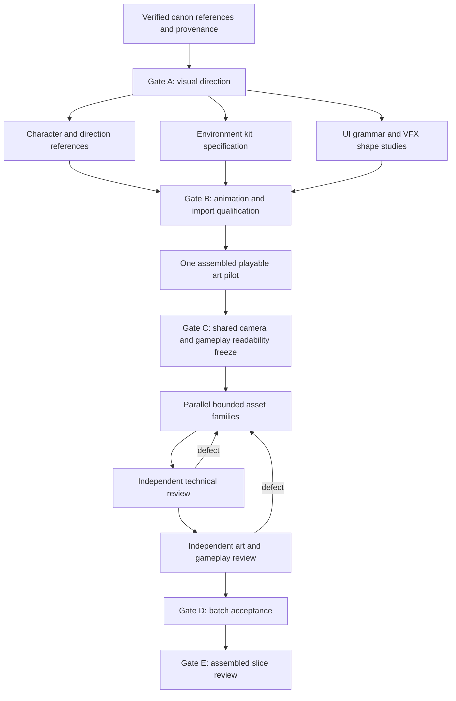

# AI art production playbook

This is the production handoff for a direct Trickster Online fan remake: Bunny first, Coral Beach as the combat field, Megalopolis as the later hub, and the original eight animal classes as the eventual roster. PC combat comes first; online systems come later. Reimagine the canonical characters and locations through newly generated assets. Do not rename the project into an original-IP substitute and do not extract or redistribute the original game's asset files. Canon clearance is dependency-local: Bunny, Coral Beach, drilling and selected enemy/pet references are enough for their pilot; unrelated roster research must not block it. Canonical motifs must be checked against a verified visual reference pack before final model sheets; memory and plausible generated details are not evidence.

The objective is warm, playful Trickster identity with modern painterly presentation and readable, responsive action inspired by Hades. Hades informs action clarity and visual hierarchy, not traced compositions or copied character designs. All values below are proposed production targets until an actual Godot calibration proves them.

## Deliverables and readiness

Keep three deliverables distinct: (1) visual direction presentation, (2) a working animated production pilot, and (3) accepted runtime assets. A beautiful scene illustration is not a modular environment kit. A generated sprite sheet is not proven animation. A generated turnaround is not an exportable rig.

**AI-only production definition:** all visible illustration/texture/animation-source art is AI-generated or AI-authored through the qualified route. Agents may write scripts for registration, layer assembly, rigging, animation, packing and export; human review and direction are allowed. No human drawing or hand-animation is assumed as an unpriced rescue step. Stock fonts/input glyphs require explicit licensing/provenance and are utility dependencies, not claimed AI artwork. Missing mesh/rig/motion tooling is a capability blocker.

Image generation can establish concepts and controlled images but cannot be assumed to guarantee frame registration, stable anatomy, directional consistency, rigging, motion export or repeatable seeds. Before mass production, qualify an available animation route with actual tool outputs and playback. If none passes, deliver the concept/reference package and report the specific animation capability gap; do not label the pipeline ready.

## Shared calibration contract

| Field | Proposed target | Gate requirement |
|---|---|---|
| Platform/view | PC; 1920×1080 reference viewport | Check actual viewport and smaller display readability |
| Ground lattice | Basis vectors (64,32), (-64,32); reference cell 128×64 px | Validate camera, sprite projection and world scale together; 2:1 ground axes alone do not determine sprite camera elevation |
| Actor source | 512×512 px; foot pivot (256,420) | Every frame stays on the same canvas and pivot |
| Standing actor | 320 px foot-to-skull-crown height, excluding ears/headgear → 144 px screen body height | Initial render scale 144/320 = 0.45; do not scale using full canvas height |
| Facing | Eight named directional references | Production direction count requires animation pilot approval |
| Alpha/color | Straight alpha; sRGB color textures | Verify Godot import and filtering; inspect edge halos |
| Shadows | Separate ground shadow by default | Avoid directional baked shadows contradicting runtime light |
| Timing | Explicit semantic phases, separately authored playback duration | No universal animation frame-rate or fixed combat-timing promise |
| Occlusion | Foot-based ordering plus explicit tall-prop policy | Verify overlap and player visibility in assembled scenes |

The game-design owner and art director freeze revised values together after calibration. Every subsequent batch cites that contract version. A camera or scale revision invalidates dependent exports; do not silently rescale individual assets to hide a shared defect.

## Visual invariants

- Canonical Bunny landmarks, costume motifs and proportions come from the verified reference pack. Label modern reinterpretations explicitly. No blind mirroring of asymmetrical costumes, readable symbols or handed weapons.
- Preserve the relaxed exploration/discovery mood, animal-class expressiveness, approachable monsters, digging and reward identity alongside more responsive combat.
- Use broad painted color masses, controlled texture, deliberate silhouette edges and separated material groups. Ground detail must remain quieter than actors and imminent threats.
- Reserve visual contrast and specific threat shapes for combat information. Color supplements shape. Friendly effects and enemy danger must remain distinguishable in grayscale and color-vision simulations.
- A single environment lighting policy governs props and actor rendering. Avoid contradictory highlights, arbitrary camera angles, photoreal texture intrusion and baked full-screen glows.
- UI text remains live engine text. Generated images must not contain required labels, item statistics or localization content.

## Dependency graph and stage gates



**Gate A — direction.** Compare a small number of genuinely different treatments using the same Bunny pose, Coral Beach scene and gameplay-scale composition. Check canonical identity, warmth, painted material language, ground hierarchy and action readability. Approve one reference pack rather than combining incompatible favorites.

**Gate B — capability.** Demonstrate one actor, directions, core actions, one terrain family, one telegraph, one impact and one digging/discovery interaction. Actual playback and an import test are required. Tool availability is evidence, not a promise. Preserve source artifacts and the exact route used.

**Gate C — composition.** Assemble exploration, ordinary combat and a deliberately crowded combat scene. Validate feet, weapon reach, enemy windups, tall props, ground telegraphs, camera and HUD together. Freeze the shared contract only after this passes.

**Gate D — family acceptance.** An independent reviewer checks the whole batch and issues asset-specific defects. The coordinator accepts only after technical, art and gameplay review. Failed candidates remain outside runtime exports.

**Gate E — slice acceptance.** Show captured playback and screenshot matrix for exploration, dense combat, prop occlusion, drilling/discovery and HUD interaction at intended size. A presentation illustration cannot substitute for these checks.

## Seven-slot allocation and optimal waves

Maximum concurrent population: coordinator plus six workers. Default allocation is coordinator, game-design/implementation owner, CHAR, ENV, VFX/UI production worker, ANIM production worker and independent REVIEW. CHAR, ENV, VFX/UI and ANIM are the four domain workers; VFX and UI are separate briefs executed sequentially by that worker when needed. Do not spawn an eighth agent to keep every specialization alive.

| Wave | Allocation | Dependency discipline |
|---|---|---|
| Reference/direction | Coordinator; design; CHAR; ENV; VFX/UI; ANIM qualification research; REVIEW | Production is limited to studies until reference and direction approval |
| Pilot | Coordinator; design; CHAR source; ENV kit; VFX/UI pilot; ANIM pilot; REVIEW | Concentrate on one complete loop, not broad content throughput |
| Production | Coordinator; design; CHAR batch; ENV batch; VFX or UI batch; ANIM batch; REVIEW | Each batch owns a coherent family and consumes approved references |
| Dual independent review | Coordinator; design; independent art reviewer; independent technical reviewer; up to three unaffected production workers | Reassign an available domain worker to review assets they did not create; pause their production if necessary |
| Integration | Coordinator; design; reviewer plus only workers addressing measured integration defects | Do not generate unrelated assets to fill slots |

The game-design owner supplies gameplay review and future implementation continuity. When that owner authored integration code, an independent technical reviewer checks that code and import evidence. A producer cannot approve its own family. The coordinator owns final acceptance and cross-family decisions. Agents may self-check but must not mark themselves accepted.

Partition by asset family, not by arbitrary frames: one monster plus all actions, one biome kit, one skill through every phase, one UI family. Splitting Bunny's north/south views across independent agents before a proven shared source pipeline invites identity drift. Parallel prompt writing is cheap; incompatible output integration is expensive.

## Animation qualification and frame inventory

Run a tiny route screen first: idle, locomotion and primary attack in SE/NW, plus E/W handedness evidence (B02/B03). Select a viable route before the broader Gate B qualification of directions, dodge, hit and drilling. Full P1 clips follow Gate C. This avoids producing every action through several competing routes.

Test the same Bunny design and core action with available routes:

| Route | Useful strengths | Must prove |
|---|---|---|
| Referenced image/frame generation | Painterly keyframes and bounded actions | Stable landmarks, anatomy, projection, foot origin, temporal coherence and economical correction |
| AI-created 3D/2.5D source rendered to sprites | Reusable directions, motion and lighting | Actual mesh, rig, weights, animation clips, export tooling, painterly result and equipment clipping checks |
| Direction-specific layered 2D puppet | Ambient motion, portraits, selected simple actors | Foreshortening, silhouette change, believable joints and no rubber-limb artifacts |

Do not assume an image tool provides meshes, rigs or temporal generation. Use a route only after producing a valid sample. Retain an explicit four-direction production fallback if eight-direction coherence fails; make the gameplay implications visible before approving it.

Illustrative pilot inventory: idle 6 + run 8 + dodge 6 + basic attack 10 + hit reaction 3 + drill 8 = 41 frames per facing, or **328 frames at eight directions**. At four directions it is 164. These are capacity estimates, not animation specifications: some clips might be nondirectional, some transitions require more frames, and pose reuse requires testing. Death, skills, weapons, costume changes and companions are additional scope. An inventory of 8 directions × 12 actions × 10 frames × 10 costumes already reaches 9,600 frames before weapons and effects.

The 328-frame inventory is illustrative and incomplete for P1: the real slice manifest must additionally cover the skill, defeat, interaction, drill plant/resistance/abort/reveal/retrieve/celebrate, companion states, and enemy notice/windup/active/recovery/hurt/defeat as applicable. Agree action-specific direction counts before estimating final volume.

Start with one Bunny outfit and one weapon. Keep movement separate from aim/facing semantics. If aiming away from travel is supported, qualify strafe/backpedal poses or an explicit turn/slide presentation policy; eight reference directions alone do not solve locomotion. Define startup, contact/active, recovery and cancellation markers; duration belongs to runtime data and must be validated with input response. More generated frames do not guarantee responsive combat. A dynamic pose cannot stand in for every action phase.

## Minimum slice and kit boundaries

Produce Bunny; two normal enemy archetypes (melee and ranged, canonical choices pending references); one elite with readable silhouette and behavior difference; one compact Coral Beach field containing entry, combat clearing, drilling patch, landmark and social/return edge; one guide/merchant placeholder pending canon approval; one canon-verified companion with minimal idle/follow/emote/discovery-assist coverage and low-priority effects; basic attack, dodge and one utility/area skill; drilling, discovery and loot feedback; minimal HUD. Megalopolis receives an establishing visual study and modular-kit plan before a later playable hub expansion.

Environment output must include a kit map: ground variants, traversable edges, collision boundaries, corners, transitions, occluders, prop footprints, foreground/background rules, drilling surfaces and landmark placement. A single seamless image with no editable traversal structure does not pass ENV.

## Asset registry and file contract

Keep immutable generation outputs. Corrected candidates receive new versions. Suggested folders: `briefs/`, `references/`, `source/`, `candidates/`, `accepted/`, `manifests/`, `reviews/`, `contact-sheets/`, `exports/`. Only accepted exports enter runtime asset directories.

Example manifest; values marked provisional remain provisional until Gate C:

```yaml
asset_id: actor.bunny.run.ne.v001
status: candidate
canon_status: reference_verified_or_pending
brief_version: visual-bible-001
camera_contract: calibration-001-provisional
source_reference_ids: [bunny-turnaround-v003]
generator:
  tool: actual-tool-name
  model_version: record-if-exposed-otherwise-unavailable
  generation_id: record-if-exposed-otherwise-unavailable
  seed: record-if-supported-otherwise-unavailable
  prompt_file: prompts/bunny-run-ne-v001.txt
  edit_history: []
provenance_notes: Newly generated; reference sources listed separately; no extracted game files
type: actor_animation
direction: ne
canvas_px: [512, 512]
foot_origin_px: [256, 420]
standing_source_height_px: 320
render_scale: 0.45
frames: 8
frame_files: []
loop: true
phase_markers: {}
playback_duration_ms: pending_gameplay_validation
visual_bounds: pending_measurement
hurtbox_definition: separate_runtime_resource
ground_footprint_world: pending_gameplay_contract
attachments: [weapon_hand]
alpha_mode: straight
color_space: srgb
shadow: separate
export_format: png
review:
  technical: pending
  art: pending
  gameplay: pending
```

Also record source URLs/access dates and interpretation notes in reference manifests, tool limitations, source layers/rig when available, transform/export commands, import preset, atlas membership/padding and accepted artifact hashes. Never invent unavailable seeds or promise deterministic regeneration. Pixel dimensions do not define hurtboxes. Runtime hit volumes and collision remain separate data.

## Verification and bounded iteration

Technical review checks dimensions, expected file count, alpha, fringe, crop, frame order, pivot stability, direction mapping, loop seams, import filtering, atlas bleed, decoded texture memory and missing source/manifest data. Memory is estimated from decoded textures and mipmaps, not compressed PNG size.

Art review checks costume/anatomy landmarks across all frames and views, canon evidence, coherent materials and camera, palette roles, painterly finish, readable silhouettes and actual game-scale appearance. Review full contact sheets and playback, not selected attractive stills.

Gameplay review checks foot sliding against world speed, visual bounds versus hurtbox, weapon art versus effective range, startup/active/recovery distinction, cancellation presentation, overlapping telegraphs, dense effects, tall-prop occlusion, calm exploration and drilling/loot recognition. Color-vision and grayscale previews supplement actual scene tests. Animation quality cannot be verified solely through still-image inspection.

For each batch, allow an initial candidate and at most two targeted correction rounds before escalation. Each retry must cite a defect and test a changed diagnosis or controlled parameter. After two unsuccessful correction rounds, reduce scope, revise the method, or reopen a shared contract with coordinator approval. Do not repeat unchanged prompts indefinitely. Reject statuses: `reference-blocked`, `technical-reject`, `art-reject`, `gameplay-reject`, `tool-capability-blocked`. Preserve rejected candidates and reasons for audit; do not use them in runtime to hide schedule pressure. A shared-contract defect pauses affected families only; unaffected work may continue.

## Copyable task prompts

Every prompt below requires the approved reference pack, visual bible and calibrated contract as attachments. If absent, deliver explicitly labeled studies and a missing-input report, not final production assets. All agents record prompts, source references, exposed tool metadata, edits and source files. No agent self-approves.

### CHAR — Bunny and creature reference family

You own the assigned character/creature family for a direct Trickster Online fan remake. First target is Bunny, with canonical motifs verified against the supplied reference pack. Reimagine through newly generated art; do not rename or extract original assets. Produce silhouette alternatives, approved color/material sheet, front/back/side and eight directional references, face/expression sheet, weapon/gear landmarks and attachment notes. Distinguish verified canon from intentional modernization. Follow the supplied camera/scale contract. Preserve ears, hair, costume, dominant hand and weapon landmarks across views. Show actual game-scale silhouettes on light and dark Coral Beach ground. Do not independently choose a new camera, palette or outfit after approval. Deliver candidate images, source files where available, manifest, full contact sheet, canonical interpretation notes and defect/uncertainty report. Review is external. Own the companion model/reference family too when assigned; canon verification and low-priority effect rules still apply.

### ENV — Coral Beach modular field and Megalopolis study

You own the assigned environment family. Build a newly generated Coral Beach kit consistent with verified references and the shared grid/camera. Deliver terrain/edge/transition inventory, modular prop family, footprints, collision guidance, occluder rules, drilling-surface variations, landmark and assembled exploration/combat/crowded-combat mockups. Mark traversal and obstruction separately from visual bounds. Show tile adjacency and repetition tests; avoid noisy ground beneath actors. Provide a Megalopolis establishing study and future kit plan only unless a later brief expands scope. No extracted game tiles, baked UI text or single flattened illustration substituted for a kit. Deliver source/candidate files, kit map, manifests, game-scale composites and explicit coverage gaps.

### ANIM — qualify the route, then produce Bunny action family

You own animation feasibility before volume. Use the approved Bunny references and compare only available routes: controlled referenced frames, AI-created rig/rendered sprites, or directional layered puppets. Do not assume the image generator supports rigs or coherent video. Demonstrate idle, run, dodge and basic attack playback with constant canvas/foot origin, stable landmarks and direction mapping; then qualify hit/drill actions. The full slice manifest also needs the approved skill, defeat, drilling abort/discovery/retrieve/celebrate, companion idle/follow/emote/discovery-assist and enemy windup/active/recovery/defeat coverage. Test strafe/backpedal or a documented turning fallback if move and aim differ. Use eight direction references; propose a four-direction fallback only with explicit visual/gameplay tradeoffs. Record source/rig/layers and reproducible export steps where supported. Deliver all frames, clip manifests, phase markers, full playback, pivot overlays, loop tests and foot-sliding test at the agreed speed. Do not invent gameplay durations or hide failures with camera movement. Stop volume generation until independent qualification passes.

### VFX — combat, drilling and discovery grammar

You own effect families for the supplied action-state contracts. Produce threat-shape grammar; player attack/dodge/skill startup, active and recovery effects; enemy warning/contact/recovery; drilling progress, discovery, loot and rare discovery variants. Separate ground telegraphs, actor/weapon effects, impacts and optional decorative layers. Show each effect alone and with Bunny, enemies, terrain and HUD at actual scale. Color must supplement silhouette, timing and shape. Avoid concealing enemy windups or implying false hit range. Deliver phase/contact sheets, alpha-ready candidates, manifests, intensity variants and crowded overlap tests. No unexplained full-scene glow or effect-only glamour illustration as final output.

### UI — PC combat and discovery interface

You own the minimal PC interface family: health/resource treatment, skill readiness, target/enemy health, interaction prompt, drill/discovery feedback, loot/item presentation and inventory/icon grammar studies. Follow the supplied input and gameplay contracts; do not invent final systems or labels. Provide native 1920×1080 layout plus smaller-display readability preview, UI scale behavior, focus/hover/pressed/disabled states where applicable, safe content areas and restrained decoration. Text and numbers stay live UI text; generated artwork supplies frames/icons/illustration only. Validate status distinction without color alone and show quiet exploration plus crowded combat. Deliver source candidates, component/state inventory, manifests, implementation notes and unresolved information needs.

### REVIEW — independent acceptance

You did not produce the assigned family. Review its entire delivered batch against the exact brief/reference/contract versions. Check technical files and metadata, game-scale art consistency, all directions and playback, canonical reference status, grayscale/color-vision previews and assembled exploration/combat/occlusion cases. For each defect record asset ID, severity, observed evidence, required correction and affected dependency. Separate objective failure from optional aesthetic preference. Do not silently revise camera or adjacent assets to compensate. Return pass/reject per technical, art and gameplay gate, plus blockers and narrowly scoped rework instructions. The coordinator alone moves fully reviewed outputs into accepted exports.

## Completion evidence

A later generation campaign is complete only when the accepted asset registry, source/provenance manifests, import profile, review reports, assembled scene screenshots, animation playback and known-limitations report agree. The first campaign should establish measured throughput and a working slice, not promise an entire eight-class online game from unqualified concept-generation speed.
