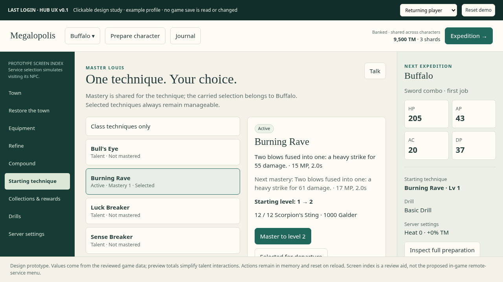

# Megalopolis UI/UX design — v0.1

Status: proposed interaction design, based on the gameplay/hub audit of `c7b2765`. Date: 22 October 2026. This proposal does not change gameplay code, resource values, or the existing persistent-equipment decision.

Open the [clickable prototype](hub-ui-prototype.html) in a browser. It runs offline and never reads or writes a game save. Use the returning-player and fresh-player profiles to inspect different states. Transactions are in-memory demonstrations; refinement outcomes are scripted, compound results use a midpoint, and attribute previews simplify talent effects. The screen index simulates visiting an NPC; it is not a proposed remote-service menu.

## 1. The player experience we are designing

The town should answer three questions quickly:

1. **What happened on my last expedition?** What I kept, what I lost, and what changed.
2. **Who am I playing next, and what am I taking?** A dependable view of one prepared character.
3. **What do I want to accomplish next?** An optional hunt, upgrade, or restoration goal.

The recurring loop is **return → choose character → prepare → depart**. Service visits are optional branches from preparation. Returning players can keep the same preparation and leave quickly; interested players can spend time comparing options and talking to people.

The explorable square remains the center. Players visit familiar NPCs; repeated service use should not require repeatedly dismissing introductory conversations. A small character/preparation window and journal are available anywhere in town. NPC transactions remain local to their NPC. A town directory can show locations and reopen conditions without granting remote crafting.

This design preserves the current four attribute families, eight regular characters, shared persistent collection, full-strength stored equipment, monster materials, collection sets, and configured services. It does not add a new currency, replace the job system, rebalance prices, or change death-loss rules by implication.

## 2. A single prepared character

Selecting a character keeps the player in town and updates the character they control and inspect. It never starts an expedition.

**Shared account state:** banked currencies/materials, owned equipment instances, owned wardrobe/drills, collection progress, mastered technique levels, restorations, best Heat, and story milestones.

**Per-character preparation:** selected equipment instance IDs, wardrobe choices, one mastered starting technique, and drill preference. These per-character preferences are a proposed improvement over the present shared equipment loadout. They reference shared ownership and do not duplicate items. Changing one character's preference does not destroy another's. Since only one character departs at a time, a shared piece can be selected in several characters' plans.

**Next-expedition settings:** the chosen Heat configuration and destination. Keep Heat account-wide initially, matching current behavior; show it clearly when switching characters.

Every screen reads the same preparation snapshot. Selecting a piece, completing crafting, buying a restoration, or changing a starting technique updates that snapshot immediately. A preview must not be a secretly initialized combat run. Switching between menus must not roll rewards, consume the next seed, restore HP, alter ownership, or reset technique eligibility.

The display distinguishes **owned**, **selected**, and **currently usable**. Buying a drill or wardrobe piece adds it to the collection; an explicit Equip/Carry action changes preparation. Mastering a technique does not silently replace the selected starting technique. If the selected technique is improved, its displayed starting level updates immediately.

An incompatible selection produces an explanation and a valid choice, not a broken character. A character's own starter is available when no stored weapon is selected. Guns and shields explain their mutual exclusion before the player changes preparation. Lost/discarded equipment invalidates references visibly. The final gate cannot accept a stale item reference.

## 3. Screen anatomy and navigation

### Common service window

A dedicated service window replaces the generic dialogue choice list for economic transactions.

- **Header:** NPC name, service name, one short purpose sentence, optional Talk, Close.
- **Selection area:** searchable or filtered records; current selection is distinct from owned/equipped status.
- **Detail area:** effect, current → proposed result, costs, availability, risk, and source information.
- **Action area:** specific verb and object: `Master to Lv 2`, `Attempt +3`, `Claim Bunny's Ears`. Insufficient resources include a reason; disabled color alone is insufficient.
- **Prepared-character summary:** selected character, relevant attributes, starting technique, drill, Heat, and an Inspect link. Show attributes relevant to the current service before expanding all twelve.
- **Banked-resource context:** TM/shards in town progression views; Galder/ore at Marx; material counts at Paul/Louis. Never show run-pocket amounts where a service spends banked resources.

Use a restrained, high-contrast interface with clear typography, familiar item/attribute naming, stable action placement, and predictable focus. The prototype explores a warm paper background, deep green navigation, and gold resource accents; these are interface treatment suggestions rather than a new world-art brief.

At 1280×720, lists scroll internally, details remain readable, and the primary action/Back are reachable without scrolling the entire game viewport. Smaller windows collapse the detail column into a single flow. No decision depends only on a hover tooltip, icon, animation, or color. Long item names wrap without moving action targets unexpectedly.

### Navigation contract

- `F`: interact with the nearby NPC, with one clear nearest-NPC prompt.
- `C` / existing character binding: preparation window while free in town.
- Escape: back one stage, or close the current service; never accidentally discard a configured purchase or depart.
- Numeric shortcuts supplement pointer and directional navigation; lists longer than nine remain usable through focus and scrolling.
- On opening a modal, move focus inside it; trap focus there; restore it to the originating control on close.
- A controller uses the same focus order and visible prompts. Include bindings and real controller testing during Godot implementation; the browser prototype does not establish controller support.

Only one interaction owns input at a time. An automatic story introduction queues until free movement; it cannot interrupt a transaction or open a second dialogue session. Departure also owns input until the scene transition is complete.

## 4. Arrival and the town overview

A brief, dismissible return receipt appears after the expedition, with a persistent copy in the journal. It shows:

- Outcome and actual region/room reached, distinguishing regional victory from full expedition completion.
- Banked TM/shards and banked leftover currencies/materials, using the actual retained amounts.
- Items kept, items lost, and a direct explanation of the lost bag and its replacement rule.
- At most two useful changes, such as `A set is ready to claim` or `Louis can improve your selected technique`.

The town then returns control. No mandatory tour of every affordable service. No automatic spending, auto-equipping, or departure.

The optional overview contains the active character, Prepare, expedition summary, tracked hunt, and a directory of NPCs. It distinguishes open services from closed ones. Closed entries say what restoration opens them and let the player view that restoration with Cavalier.

First arrival provides a short objective—choose a character and explore past the gate—with an optional introduction to preparation. All eight regular characters are currently available; the introduction must not promise a nonexistent Bunny unlock. Unmet NPCs and new milestones can have one restrained marker, cleared when acknowledged. Ordinary unaffordable upgrades should not produce permanent notification badges.

## 5. Character and expedition preparation

The character view preserves the familiar relationships between equipment and the twelve stats grouped under Power, Magic, Sense, and Charm.

Main contents:

- Character switcher and class/basic-attack explanation.
- Equipment slots and character preview; items available from the shared collection.
- Wardrobe tab identifying these pieces as persistent mechanical bonuses.
- Starting technique, including whether it is an active skill or talent.
- Drill and Heat summary.
- Attribute totals and source breakdown on inspection: class base, selected items, wardrobe, restoration, and starting talent effects.

Keep future/unimplemented slots clearly inactive, without presenting them as broken controls. Do not introduce an aggregate gear score that obscures AP/MA/DA/AC/HV tradeoffs. Comparisons use the relevant attributes and concrete effects, not unexplained arrows or a universal “better” color.

Choosing an item previews its effect, checks compatibility, and then changes preparation. It does not heal a live character. Unequipping returns to an empty slot or the character starter; it does not sell or discard the item. Destructive collection operations are separate from wearing choices.

The full-strength loadout rule remains. A strong stored item is not silently level-synced or reduced for preview. Per-character preferences and stable instance IDs must exist before this flow is considered complete.

## 6. NPC service specifications

### Don Cavalier — restore the town

Organize restorations into **Reopen services** and **Permanent expedition benefits**. This accurately represents the current mixed implementation without resolving the separate balance decision about flat bonuses.

Each restoration detail shows:

- Current rank and resulting next rank.
- Concrete benefit and scope: all characters, town service, or next expedition.
- Price and missing resources.
- Dependencies or practical requirements.
- What becomes available immediately and where to use it.

Example: `Training Hall 1 → 2 · Starting HP bonus +15 → +30 · Costs 6,000 TM`.

For Skill Shrine, explain that normal monster-material drops require Compounder's Stall, while restored run shops and drilling offer other sources. This is guidance, not an invented hard prerequisite. A knowledgeable player may still restore Louis first.

Purchasing a restoration updates the town/NPC availability and preparation snapshot together. The receipt names the newly opened service and offers an optional Visit action. Closing the receipt keeps the player in control.

Job Hall describes advancement for the selected character instead of universally promising Knight. It currently enables expedition trials; do not imply a separate hub Job Master interface already exists.

### Keeper Julio — equipment collection and wardrobe

Equipment and wardrobe are distinct tabs within the same preparation context. Equipment lists support slot, compatibility, and selected-state filters. Selecting a slot opens fitting items without losing the character comparison.

For each piece, show stable identity through title, refine level, compounds, and relevant stats. “Selected by another character” is informative, not a restriction or duplicate item. Show both accessory destinations and which one will be replaced.

Wardrobe pieces show their permanent stats and quirk. Acquire and Wear are separate. An empty wardrobe choice remains intentional; a later reward does not silently fill it.

Collection expansion and discarding are secondary actions. Discarding a selected item identifies affected character plans and asks for explicit confirmation. Resolve references atomically. Never expose or rely on warehouse array indices in the player experience.

### Blacksmith Marx — refining

Left: stored items. Right: current state, successful result, chance, exact banked cost, and failure consequences. A toggle/filter can show selected equipment first.

Explain why town forging differs from expedition anvils: three times the Galder cost and base chance, without run LK/trait bonuses. Show the final chance used by the operation.

One press buys one attempt. Disable repeat submission while resolving. After resolution, keep the same item selected and show success/failure, consumed resources, final refine level, and updated preparation. Do not queue held-button attempts.

Below the downgrade threshold, the explicit attempt button is sufficient. At levels where failure may reduce refinement, surface the downgrade risk prominently and require a deliberate acknowledgement when entering that risk tier. Avoid asking for another generic confirmation on every subsequent low-impact attempt.

### Compounder Paul — material, target, permanent slot

1. Select a material, with owned/required amount, producing monster/region, and effect range.
2. Select a stored item with a free slot.
3. Compare current stats/compounds and see the proposed addition and consumed slot.
4. Commit the permanent slot consumption; show the resulting roll and updated item.

Do not invent slot/material restrictions absent from game data. Recommendations may highlight relevance to the selected character without forbidding alternatives.

Explain that town rolls use base quality and expedition compounding can benefit from DA and relevant modifiers. Track Material opens a journal goal without changing the selected item or spending anything.

### Master Louis — mastery and starting technique

The list has **Selected**, **Mastered**, and **Eligible** states. The selected technique remains visible even when already granted to the preparation preview. Persistent eligibility must not reuse “can learn as new this run.”

Each detail shows active/talent type, technique behavior, current mastery, next starting level, material count/source, Galder cost, and maximum mastery. Keep `Master` and `Carry into expeditions` separate. If mastery improves a selected technique, update its selected level automatically. `Class techniques only` clears the extra selection immediately.

Techniques that cannot start this character's first job should have an inspectable explanation or an appropriate “later techniques” view, rather than implying every acquired technique can be selected. Do not promise that mastery raises the ordinary run-level cap; it currently raises the selected starting level.

### Card Hunter Eugene — collections and reward shop

Collection pages show discovered and missing monsters, source region/area, counts, completion, and reward. Overlapping sets explicitly share card progress and do not consume cards on claim.

A claim grants ownership and marks the set claimed in one transaction. The receipt offers `View in wardrobe`; it does not replace current preparation. Already-owned rewards should explain that state without implying a second equipment instance.

The separate reward shop shows price, owned state, and mechanical effect. Buying a piece adds it to the shared collection. Missing cards can be tracked in the journal, with useful area guidance.

The UI may show Caballa cards as discoveries, but must not advertise set rewards that are not configured. Adding those rewards or a duplicate-card exchange is future content, not an implicit part of this UI implementation. Duplicate counts should remain visible so ownership is understandable.

### Driller Marky — drills and handling practice

Every drill shows maximum depth, scoop per good strike, strike count, marker speed, zone width, and how DA affects handling. Show the meaningful reward thresholds: ore 5, materials 15, gear 40, shard 70.

Compare handling as well as depth. For example, Cleaner is deeper than Basic but its base timing window is substantially shorter. Do not imply that a more expensive drill is unconditionally easier.

`Try handling` is a proposed small addition: a no-cost, no-reward practice version of the existing timing interaction. Players can try an unowned drill before purchasing it. Stop it on close or focus loss; Space acts only while practice owns input. A text result accompanies the timing feedback.

Purchase and Carry are separate; owned tools stay available. The Basic Drill is granted once when its restoration opens, with a consistent ownership record. Noise warnings must match the reward policy: if an ambush adds a fight, queue the discovered gear until that fight resolves instead of silently deleting it.

### Guide Sabrina — next-expedition difficulty

Use direct +/- controls with clamped ranks. Edits are a draft until Save. Back/Escape on a changed draft offers Keep Editing or Discard; changing screens cannot accidentally commit it.

Always show resulting Heat, TM bonus, gear-band increase, new-clear bounty, account best, and active restrictions. Explain that the bounty is shared across characters and paid for new best Heat, not every successful run.

Expand rules when needed: Hardcore removes specified doors/revives, not all healing. Drops Nerfed currently reduces ordinary random drops rather than guaranteed elite/boss quantities. The final implementation must either use that wording or explicitly change the underlying rule. Fixed-timer boss warnings and common attack windups also need an agreed scope.

Do not recommend a difficulty automatically from an unsupported gear score. Let the player compare to their previous expedition and choose.

### Miranda, Stella, and the Copper Plate — narrative interactions

These currently provide conversation/story progression. Give each an inspectable interaction and acknowledge new milestones once. Do not add empty Shop or Quest buttons for unavailable functionality.

Milestones distinguish discovered versus currently owned shards, region completion versus expedition completion, and a new service versus a new character unlock. Repeated service access is independent of conversation completion after the first introduction. Optional Talk remains available at functional NPCs.

## 7. Hunting journal and lightweight goals

A journal unifies material sources, missing cards, return receipts, story discoveries, and one optionally tracked hunt. It supplies directions rather than a mandatory task list.

`Track material` records what, where, current banked amount, and desired quantity if the player chose a mastery/compound target. `Track set` records missing cards and relevant areas. Mark a goal complete from actual state changes, and let the player untrack it. Tracking never changes expedition rewards or spends resources.

Use the existing den and material relationships for guidance. A proposed guidance message is `Cool Ice · Blue Penguin · Coral Beach`; do not promise a guaranteed drop. Once the player enters a run, the journal can inform existing den choices without adding a new reward system.

An affordable upgrade should produce a contextual opportunity, not an obligation. Limit town overview suggestions to a small number; let the player ignore them and depart.

## 8. The expedition gate

Approaching the gate opens a compact review of the already selected character, not character selection.

Show:

- Character/basic attack, selected starting technique, equipment and wardrobe summary.
- Drill, destination, region sequence, 32-room scope, and Heat rules/rewards.
- Important missing systems, e.g. `Job Hall closed: no job changes this expedition`.
- Death-loss exposure from the current equipment and WT rule, plus an existing lost-bag warning.

Distinguish **hard errors** from **valid choices**. Unknown/unowned item references and incompatible gear block departure with a direct Fix action. No extra mastered technique, empty accessory slots, low currency, unclaimed rewards, and an unrestored service do not block departure.

Death messaging must be precise: WT saves some worn pieces; at least one qualifying piece is bagged; shelves may be needed for newly found items; another defeat with gear to lose can replace an earlier bag. Do not simplify this to “everything is safe below WT.”

`Begin expedition` freezes a validated preparation snapshot and initializes the actual run once. Double submissions are ignored. A scene-load failure leaves preparation intact and returns to a useful error/Retry state without charging resources.

## 9. Creation, cancellation, and mistakes

Custom Trickster creation is a separate reversible wizard: kit → graph → first tree → second tree → review. Every stage has Back/Cancel. Choices remain a draft until final confirmation. Validate unlocks, duplicate trees, prerequisites, weapon/basic capabilities, and a viable starting loop using game rules. Completing creation returns to preparation; it does not immediately depart.

Do not extend supported class combinations just because a UI has space for them. The prototype demonstrates cancellation/navigation, not complete class compatibility or unlock logic.

For ordinary preparation, switching back and forth is cheap and reversible. Purchases and crafting are persistent commitments and cannot be represented as an unsaved loadout draft. A clear receipt makes the distinction visible. No general Undo button may imply it can reverse random refinement or a spent permanent compound slot.

## 10. Implementation contract for Godot

Proposed responsibilities, aligned with the repository's Resource/behavior separation:

| Component | Responsibility |
|---|---|
| Character preparation preferences | Per-character references to shared owned instances; selected wardrobe, starting technique and drill. |
| Preparation query | Build one read-only snapshot from profile/preferences/class; return stats, sources, eligibility, and warnings without calling `Run.new_run()`. |
| Economic commands | Validate affordability/ownership/capacity, apply changes once, save one coherent result, return a structured receipt. |
| Service view models | Assemble selected records, comparisons, prices, reasons, and navigation targets from shared queries. No combat math in controls. |
| Hub interaction controller | Own free movement, dialogue, service, practice, creation, and departure. One owner; explicit enter/exit/cancel. |
| Domain change signals | Notify relevant views after a transaction; rebuild affected preparation data once. |
| Run initializer | Consume the validated departure snapshot, initialize transient state and random rewards exactly once. |

Use stable item instance IDs. UI controls must not repair warehouse-index corruption themselves. A purchase, set claim, or craft command checks its conditions again on commit, even if the UI showed an enabled button. Prevent double-submit while pending and return a failure without partial mutation. Save failure must remain visible; do not announce a completed durable transaction prematurely.

Repair the previously identified ownership, timing, damage, and save bugs in their owning systems. A clearer interface can expose and prevent some invalid actions, but it cannot make corrupted identities, re-entrant damage resolution, or non-atomic saves correct.

Recommended reusable controls: service shell, record list, current/proposed comparison, currency cost/reason, material-source link, preparation summary, receipt, draft-change dialog, and modal focus manager. Dedicated service presenters keep `hub.gd` from acquiring another large transaction switch.

## 11. Implementation sequence and acceptance

1. **Preparation foundation:** stable item IDs, per-character preferences, compatibility queries, preview query, and switching while staying in town. Accept when Buffalo → Lion → Sheep → Buffalo preserves valid preferences without initializing a run.
2. **Interaction shell:** exclusive modal ownership, focus/back navigation, arrival receipt, preparation window, gate review. Accept when an automatic intro cannot interrupt another interaction and double departure creates one run.
3. **Essential services:** Julio, Louis, Marx, Paul with transactions and immediate previews. Accept when selected mastery remains visible after return and the displayed refined/compounded item matches the committed item.
4. **Progression services:** Cavalier, Eugene, Marky and Sabrina with requirements, claim atomicity, draft settings, and honest reward descriptions. Accept when fresh and partially restored profiles have understandable next choices.
5. **Journal and polish:** source tracking, optional conversations, controller prompts, small-window behavior, and result receipts. Add drill practice only after the preparation/crafting flows work.

Review using real actions at 1280×720 and a smaller supported viewport. Cover mouse, keyboard, focus navigation, Escape at every stage, long names, no resources, max ranks, empty collections, full warehouse, selected items lost/discarded, character switching, failure to save, repeated button presses, and leaving/reopening each service. Existing menu-reachability checks remain useful; add transaction and complete preparation-through-departure checks.

Usability targets are hypotheses to validate, not claimed measurements: a returning player can depart unchanged in two deliberate actions; switching character and finding its starting technique is immediately understandable; a player can explain a purchase's result/risk before committing; no essential information requires hovering or remembering a previous screen.

## 12. Scope of the prototype

Implemented as a standalone design study: fresh/returning fixtures, all eight regular character switches, per-character equipment/wardrobe preferences, restoration purchases, refinement result flow, compound commitments, mastery upgrades/selections, set claims and reward purchases, drill purchase/selection/practice, draft difficulty changes, source tracking, return receipt, gate summary and departure snapshot, and cancellable creation navigation.

Source figures were read from current class, item, material, restoration, wardrobe, collection, drill and difficulty Resources. The demo is not a balance simulator, exhaustive inventory implementation, replacement Godot UI, proof of save durability, or verified implementation of future content. It has no persistence or network dependency. Runtime game code is unchanged.

### Prototype verification

Browser interaction verification on 22 October 2026 completed 61 checks with no JavaScript page errors. Checks covered all twelve screens; character preparation persistence; mastery, restoration, refine and compound transactions; set claims; drill purchase/selection/practice; difficulty drafts; hunting search/tracking; departure snapshot; locked fresh-profile services; creation cancellation; and horizontal overflow at 1280×720, 1024×768 and 390×844. These results verify this browser design study, not the Godot implementation or complete accessibility conformance.
